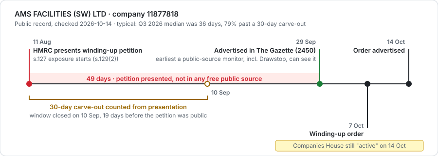
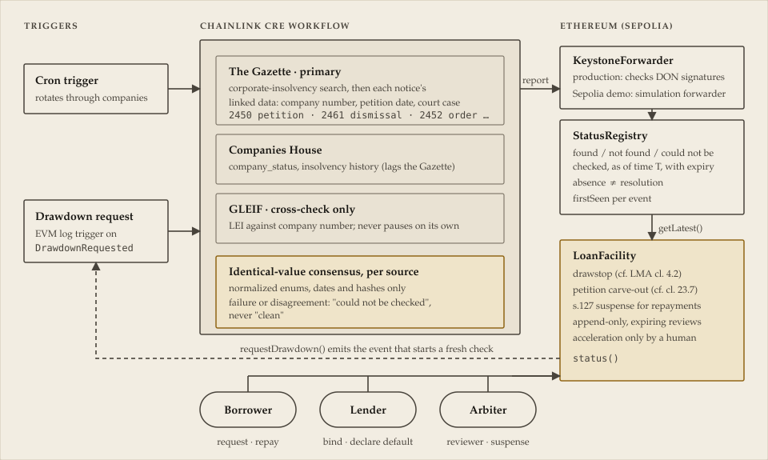

<div align="center">


# Drawstop

**English insolvency notices in. Loan drawdowns stopped, repayments held.**<br>
A Chainlink CRE workflow that lets a tokenized loan to an English company stop new drawdowns,<br>
hold at-risk repayments and call for human review when a statutory insolvency notice appears.

[](https://docs.chain.link/cre)
[](https://sepolia.etherscan.io/address/0xE1e494Ec6E87c85048b08c0F622E3BD1E98c1897)
[](#how-it-was-checked)
[](LICENSE)

[Problem](#the-problem) · [Measured](#it-is-not-one-case-a-quarter-of-petitions-measured) · [Solution](#the-solution) · [Architecture](#architecture) · [Facility states](#how-the-facility-responds) · [Trust model](#trust-model-and-honest-limits) · [Chainlink usage](#where-chainlink-is-used) · [Getting started](#getting-started) · [Demo on Sepolia](#demo-on-sepolia)

<sub>Built for BLI Legal Tech Hackathon 2 · Chainlink "Best workflow with CRE" bounty · Testnet only · Not legal advice</sub>

</div>

---

## The Problem

Under English law, a compulsory winding-up is deemed to start when the petition is **presented** ([Insolvency Act 1986 s.129(2)](https://www.legislation.gov.uk/ukpga/1986/45/section/129)). If a winding-up order follows, payments the company made after that date are void unless the court validates them ([s.127](https://www.legislation.gov.uk/ukpga/1986/45/section/127)), and the payee's good faith is not enough ([*Express Electrical v Beavis* [2016] EWCA Civ 765](https://caselaw.nationalarchives.gov.uk/ewca/civ/2016/765)).

The risk starts on one date. The world finds out weeks later:

| Gap | Consequence |
|---|---|
| A petition becomes public only when advertised in The Gazette, at least seven business days after service ([IR 2016 r.7.10](https://www.legislation.gov.uk/uksi/2016/1024/rule/7.10)). It is never filed at Companies House. | A lender watching the company register sees nothing while s.127 exposure is already running. |
| LMA-style agreements treat a pending petition as a Default that blocks drawdowns, but the facility agent may assume no Default has occurred unless it is told ([*Torre Asset Funding v RBS* [2013] EWHC 2670 (Ch)](https://caselaw.nationalarchives.gov.uk/ewhc/ch/2013/2670)). | The only reliable notice channel is the borrower itself. |
| Off-chain, a bank that learns of a petition usually freezes the company's account (bank practice, not law) ([The Gazette](https://www.thegazette.co.uk/all-notices/content/101087)). | Nobody freezes a borrower's stablecoin wallet. On-chain repayments keep flowing to token holders unless the contract itself stops them. |
| On-chain credit reacts by governance vote. | Centrifuge token holders learned of a borrower's court-ordered liquidation [53 days after the order](https://gov.centrifuge.io/t/consolfreight-cf4-pool-update-august-2023-important-notice/5674). |

> **The ask is simple:** once an insolvency notice is public, the contract that moves the money should know it before the next drawdown, and act the way the loan agreement already says.

### A real public timeline

<p align="center"></p>

| Date | Event | Public where |
|---|---|---|
| 2026‑08‑11 | HMRC presents a winding-up petition (case CR-2026-006286). s.127 exposure starts | no free public source |
| 2026‑09‑29 | Petition advertised, [Gazette notice 5219886](https://www.thegazette.co.uk/notice/5219886): **49 days later** | Gazette |
| 2026‑10‑07 | Winding-up order | — |
| 2026‑10‑14 | Order advertised, [Gazette notice 5229442](https://www.thegazette.co.uk/notice/5229442) | Gazette |
| 2026‑10‑14 | Companies House API still returns `company_status: active`, `has_insolvency_history: false` | — |

A 30-day carve-out counted from presentation had expired 19 days before the petition appeared in any free public source. A lender watching only Companies House would still have seen nothing a week after the order.

### It is not one case: a quarter of petitions, measured

We pulled every corporate winding-up petition advertised in The Gazette in Q3 2026 and checked each company on Companies House ([full study](research/petition-lag), data and scripts included).

| Measured, Q3 2026 | |
|---|---|
| Petitions advertised (with a presentation date) | 1,683 (1,594) |
| Median days from presentation to advertisement | **36** (middle half 31–41) |
| Advertised after a **30-day** carve-out from presentation had closed | **79%** |
| Advertised after a **14-day** carve-out had closed | **95%** |
| Petitioned companies with no winding-up order notice, still `active` on Companies House | 61% |
| Companies with an order advertised 1–15 Oct, still `active` on 16 Oct | 23% |
| Drawstop's Gazette check ahead of the first insolvency filing at Companies House, when the petition was advertised | median **27 days**, earlier in **99%** of 487 cases |

AMS's 49 days is typical, not an outlier.

**Drawstop could not have seen this petition earlier either:** it reads the same public notices. What it changes is what happens once a notice is public. The facility reacts on its next check instead of waiting for a governance vote, records the presentation date so that repayments already passed on since then are surfaced, and holds further repayments in suspense.

---

## The Solution

Drawstop turns statutory insolvency notices into a **consensus-verified, three-state attestation**: *as of time T, in source S, event E was found / not found / could not be checked*. A loan contract reads it and responds the way an LMA-style agreement already words it.

| | What the contract does |
|---|---|
| **Drawstop** | No drawdown while a Default, including a potential Event of Default, is continuing (cf. LMA cl. 4.2). |
| **Petition carve-out** | Times the agreement's window for a petition to be discharged, counted from presentation and optionally ending early on advertisement (cf. cl. 23.7). Whether a petition is "frivolous or vexatious" is left to human review. |
| **s.127 suspense** | Holds repayments received while a petition or proceeding is known, instead of spreading them across token holders, and surfaces repayments already passed on since presentation. |
| **Human decisions stay human** | Orders, resolutions and appointments go straight to review. Default, acceleration and enforcement are never automatic. The undrawn commitment can be cancelled by the borrower at any time, or by the lender once it has declared default. |
| **Absence is not resolution** | A petition that drops out of the Gazette results stays active until a matched dismissal (2461) or a winding-up order. An incomplete search is "could not be checked", never "not found". |

<details>
<summary><b>Legal notes</b></summary>

- **One lender or many.** The prototype pays a single lender address. In a pool that address would be a vault contract distributing to token holders, which is where suspense matters most: money spread across many holders is hard to recover.
- **New advances** are a credit risk rather than an s.127 disposition of the company's property (cf. *Coutts & Co v Stock* [2000]); the agreement's drawdown condition is what blocks them.
- **Carve-out wording** follows real agreements: Carlsberg "within 30 days of commencement"; GasLog "within seven days of commencement or, if earlier, the date on which it is advertised". Neither counts from advertisement or detection, so the contract offers neither.
- **Suspense does not make a repayment valid:** paying into a contract the lender controls is still a disposition (cf. *Re Gray's Inn Construction* [1980]). It keeps the money in one place, returnable to a liquidator or releasable after a dismissal or validation order, instead of spread across many holders it could never be recovered from (`repaidSincePetitionPresented` lists what already went out).
- **Reviews** are append-only, expire, apply only to what the latest attestation shows, and cannot cover a new occurrence or release suspense. A winding-up order clears only by review.
- **"Could not be checked"** also covers a Gazette search with more results than one page, or more notices than one run can confirm.

</details>

### Compared with what already exists

| | Commercial alert + a person | CRE covenant monitors (Covenant Sentinel, SentinelFi) | **Drawstop** |
|---|---|---|---|
| Data | Companies House, Gazette, court data | Financial covenants, from mocked data | **Statutory notices from live registries** |
| Sees petitions before advertisement | Some do (Red Flag Alert claims up to 7 weeks) | — | **No** |
| Where the response runs | A person sends a pause transaction | Loan or token contract | **Loan contract** |
| Response mirrors the agreement's clauses | Manual | Covenant breach → freeze | **Drawstop, carve-out window, review** |
| s.127 repayment suspense | Manual | Not described | **Yes** |
| "Could not be checked" kept distinct from "clean" | Up to the reader | Not described | **Yes, on-chain** |
| Default decided by | Lender | Not described | **Lender, never automatic** |

<sub>Covenant Sentinel and SentinelFi as described on their Chainlink hackathon pages; we have not read their code.</sub>

**Not new, and we do not claim to beat it:** Companies House and Gazette monitoring (Creditsafe, Red Flag Alert, Company Watch), and the pattern "CRE monitors a source, the loan contract freezes". **For a single off-chain loan, a commercial alert and a person are enough.**

**Why it has to live in the contract:** an alert reaches a person, who must then send a pause transaction; the drawstop belongs where the money moves. There is no bank to freeze a stablecoin wallet. Many investors need one tamper-evident timeline that no single operator controls (which holds only once the registry owner is not a party; see the [trust model](#trust-model-and-honest-limits)). And "could not be checked" must stay distinct from "clean".

**Sources are pluggable.** The Gazette is the statutory confirmation, not the fastest source. A court-data feed that sees petitions earlier could be added as another source (e.g. through Confidential HTTP) without changing the facility; we have not done so.

### Who it is for

A hypothesis from statute, case law and on-chain incidents; we have not interviewed users.

| Who | What they get |
|---|---|
| **Facility agents and pool delegates** of on-chain credit with UK borrowers, SPVs, originators or servicers | The drawdown condition checked on fresh evidence at every request, and a timestamped record of when an event became known (`acknowledge`, cf. *Torre*) |
| **Lenders and token holders** | One shared, tamper-evident timeline, and repayments that are not spread across holders while a petition is live |
| **Any on-chain lender, without our facility** | The `StatusRegistry` attestation alone: any contract can read `getLatest(entityId)` for a monitored UK company |

Today there is no public English-law corporate loan issued directly on-chain to a UK operating company, so Drawstop is a control prepared for a market that is forming (Property (Digital Assets etc) Act 2025, the Digital Securities Sandbox, FCA PS26/7), not a fix for a past UK on-chain default.

---

## Architecture

<p align="center"></p>

| Component | Role |
|---|---|
| [`status-monitor/`](status-monitor) | CRE workflow (TypeScript). **H2** cron monitors every registered company; **H3** runs a fresh check when a borrower requests a drawdown (EVM log trigger). Each source is fetched and normalized per node, then agreed by identical-value consensus. |
| [`StatusRegistry.sol`](contracts/evm/src/StatusRegistry.sol) | CRE receiver. Stores the latest attestation per company, the start of each event's current occurrence, and rejects out-of-order, future-dated or overlong reports. |
| [`LoanFacility.sol`](contracts/evm/src/LoanFacility.sol) | Bilateral facility for one known, lender-verified borrower: binding, drawstop, carve-out window, s.127 suspense, acknowledgement, review, human default. |

| Gazette code | Meaning | Facility response |
|---|---|---|
| 2450 / 2451 | Petition to wind up | `PETITION_PENDING` (drawstop) until the carve-out window ends, then `REVIEW_REQUIRED`; straight to `REVIEW_REQUIRED` if the window has already closed or the presentation date is unknown |
| 2461 | Dismissal (matched by court case) | Petition cleared; suspense releasable |
| 2452, 2431/2441, 2432/2443/2454, 2410 | Order, resolution, liquidator or administrator appointment | `REVIEW_REQUIRED`, no grace |

Companies House adverse status (liquidation, administration, dissolved, …) is also a hard event. GLEIF mismatches are `WATCH` only: an LEI says who an entity is, not whether it is insolvent. Full specification: [DESIGN.md](DESIGN.md). The agreement terms this behaviour would need are drafted, for illustration only, in [docs/agreement-rider.md](docs/agreement-rider.md).

---

## How the facility responds

`LoanFacility.status()` is computed from the latest attestation, the agreement's terms and the reviews, checked in this order:

| Status | New drawdowns | Meaning |
|---|---|---|
| `DEFAULTED` | blocked | The lender declared default (a human decision; moves no funds) |
| `UNBOUND` | blocked | Borrower and lender have not both confirmed the wallet ↔ company binding |
| `STALE` | blocked | No attestation, or it expired: re-check required, **not** an adverse finding |
| `REVIEW_REQUIRED` | blocked | Order, resolution, appointment or adverse registry status; or a petition whose carve-out window has closed |
| `PETITION_PENDING` | blocked | Petition advertised; carve-out window still open |
| `UNVERIFIED` | blocked | Companies House or the Gazette could not be checked: **not** an adverse finding |
| `WATCH` | allowed | LEI lapsed, insolvency history, or GLEIF ↔ Companies House conflict |
| `NORMAL` | allowed | |

---

## Trust Model and Honest Limits

**What the system relies on**

- **KYB is the lender's.** The borrower's EIP-712 signature plus the lender's transaction prove both parties *acknowledged* the wallet ↔ company binding, not that the wallet is the company.
- **The registry owner is a trust point.** It can change the forwarder, the expected workflow owner/ID/name, and which facilities may register companies, so whoever holds that key could write any attestation. On Sepolia the owner is our test wallet, which is also the demo lender. In production it should be neither lender nor borrower: a multisig behind a timelock, or ownership renounced once the production `KeystoneForwarder` and workflow ID are pinned.
- **The arbiter is a trust point.** It records reviews and resolves suspense, so it should be independent of the lender (a facility agent, trustee or security agent). The contract only limits where suspense can go: the lender, the borrower, or an office-holder nominated on-chain two days earlier.
- **A data outage blocks drawdowns** (`STALE`, `UNVERIFIED`). That shifts outage risk to the borrower, which an agreement must accept expressly: a valid attestation as a drawdown condition, with a manual fallback. The prototype has no fallback.

**What it cannot do**

- **The legal analysis is English law.** Statute, rules and cases cited are those of England and Wales. Scotland and Northern Ireland have their own insolvency rules; companies registered there are monitored through the same sources, but their procedure and notice timing are not analysed.
- **It does not see a petition before it is advertised.** "Not found" never excludes a petition presented but not yet advertised, and some petitions are never advertised at all: they can be withdrawn before advertisement ([IR 2016 r.7.13](https://www.legislation.gov.uk/uksi/2016/1024/rule/7.13)), or the court can restrain advertisement. Repayments made between presentation and advertisement cannot be stopped, only surfaced afterwards. This is a limit of the free open data, not of the law: of 401 England-and-Wales petitions advertised 1–16 October 2026, 397 (99%) sit in the High Court or Business and Property Courts ([`courts.ts`](research/petition-lag/courts.ts)), whose filings the HMCTS [CE-File public search](https://www.gov.uk/government/publications/how-to-use-the-hmcts-e-filing-service/create-a-public-search-and-request-office-copies) covers, and practitioners can ask the court's petitions registry. Neither is an open API, and we have not yet confirmed what a non-party sees there before advertisement; an authorised court-data feed could be added as one more source in the same registry.
- **Consensus is not correctness.** CRE consensus proves the nodes fetched and normalized the same data; it cannot fix a registry that is late or wrong.
- **Single-node simulation.** `cre workflow simulate` runs consensus on one node; multi-node agreement is designed, not demonstrated. Sepolia writes go through Chainlink's simulation forwarder, whose signature checking we have not verified: they demonstrate the flow, not report authenticity.
- **No direct authority** covers a smart-contract suspense account under s.127; the treatment above is our reading of the cases cited.
- **No user interviews yet.** Demand is argued from statute, case law, LMA structure and on-chain incidents. No UK borrower default has occurred on-chain that we know of; the failure mode is documented in Australia and the BVI.

**Data handling**

- No real company is bound to a test wallet. Real companies are registered for public-record monitoring only; loan scenarios use a fictional company.
- No personal data is stored: only notice IDs, codes, dates and hashes.

---

## How It Was Checked

We tried not to let the model that wrote the code be the only judge of it.

| Check | What it is | Result |
|---|---|---|
| Unit tests | [`LoanFacility.t.sol`](contracts/evm/test/LoanFacility.t.sol): one scenario per test, including the real AMS timeline and nine issues found in an adversarial audit | 42 pass |
| Invariant fuzzing | [`LoanFacility.invariant.t.sol`](contracts/evm/test/LoanFacility.invariant.t.sol): Foundry calls every action in random order as borrower, lender, arbiter, CRE forwarder and an outsider, then checks five properties after every call (suspense always backed by tokens, tokens conserved, suspense ledger balances, no forbidden action succeeds, and a reference model that independently decides which petitions or proceedings must still block drawdowns) | 5 invariants, 256 runs × 500 calls, pass |
| Mutation testing | Five bugs planted in `LoanFacility.sol` one at a time, to check that the fuzzer would notice | 5 of 5 caught (see below) |
| Deployed = source | [Sourcify](https://sourcify.dev) recompiled the repository source and matched both creation and runtime bytecode of all three Sepolia contracts (constructor arguments included). Built without CBOR metadata to fit the gas cap, so the status is `match` rather than `exact_match` | 3 of 3 match |
| Real data | Workflow parsers tested on responses recorded from the Gazette, Companies House and GLEIF; the [petition-lag study](research/petition-lag) runs the same parsers over 2,868 notices | 24 workflow tests pass |

<details>
<summary><b>Mutation testing: the judge was tested too</b></summary>

| Planted bug | Caught by | First attempt |
|---|---|---|
| M1 A drawdown may spend money held in suspense | suspense always backed | caught |
| M2 Suspense may be released while a petition is still known | no forbidden action | **missed**: random reviews rarely matched the attestation, so the path that unlocks release was never reached. Fixed by having the fuzzer review bits the attestation actually shows |
| M3 Repayments during a petition go straight to the lender | no forbidden action | caught |
| M4 A review covers an occurrence that began after it | reference model | **missed**: no invariant expressed the rule. Fixed by adding the reference model |
| M5 Expired reviews still count | reference model | caught after M4's fix |

A fuzzer that passes because it never reaches the interesting states proves nothing; the two misses are why the final suite looks the way it does.
</details>

---

## Where Chainlink Is Used

| File | Chainlink use |
|---|---|
| [`status-monitor/workflow.ts`](status-monitor/workflow.ts) | CRE handlers: cron trigger (H2), EVM log trigger on `DrawdownRequested` (H3), HTTP client with identical-value consensus, secrets, EVM read (`getMonitored`), signed report and EVM write (`writeReport`) |
| [`status-monitor/sources.ts`](status-monitor/sources.ts) | Node-mode fetch and normalization functions run by the CRE HTTP capability on each node |
| [`status-monitor/main.ts`](status-monitor/main.ts) | CRE `Runner` entry point |
| [`status-monitor/workflow.yaml`](status-monitor/workflow.yaml), [`project.yaml`](project.yaml), [`secrets.yaml`](secrets.yaml), [`status-monitor/config.*.json`](status-monitor) | CRE CLI targets, RPCs, secret names and workflow configuration |
| [`contracts/evm/src/StatusRegistry.sol`](contracts/evm/src/StatusRegistry.sol) | CRE report receiver (`_processReport`) |
| [`contracts/evm/src/ReceiverTemplate.sol`](contracts/evm/src/ReceiverTemplate.sol), [`IReceiver.sol`](contracts/evm/src/IReceiver.sol) | Chainlink receiver template (vendored; metadata length check fixed for the production forwarder) |
| [`contracts/evm/ts/generated/`](contracts/evm/ts/generated) | Bindings generated by `cre generate-bindings` |
| [`demo/run-demo.sh`](demo/run-demo.sh) | Runs `cre workflow simulate --broadcast` for each step of the loan scenario |

---

## Getting Started

**Quick check, no keys or accounts needed:**

```bash
cd contracts/evm && forge test                        # 42 unit tests + 5 invariants (fuzzing, ~1 min)
cd ../../status-monitor && bun test sources.test.ts   # 22 source tests on real responses recorded 2026-10-14
```

**Full setup:** [CRE CLI](https://docs.chain.link/cre/getting-started/cli-installation) v1.38.0 (`cre login`) · Bun ≥ 1.3 · Foundry · a [Companies House API key](https://developer.company-information.service.gov.uk/) (REST, Live)

```bash
cp .env.example .env                                  # fill in; .env is gitignored
cd status-monitor && bun install && bun test          # all 24 workflow tests
```

Simulate against live sources. Set `registryAddress` to the zero address in `config.staging.json` for preview mode, which logs the report without writing:

```bash
cre workflow simulate status-monitor --target staging-settings --non-interactive --trigger-index 0
cre workflow simulate status-monitor --target staging-settings --non-interactive --trigger-index 0 --broadcast
```

<details>
<summary><b>Repository layout</b></summary>

```
contracts/evm/
  src/StatusRegistry.sol      CRE receiver: attestations, firstSeen, report validation
  src/LoanFacility.sol        drawstop, carve-out window, s.127 suspense, reviews
  test/LoanFacility.t.sol     42 tests, incl. the real AMS timeline and audit scenarios
  test/LoanFacility.invariant.t.sol  invariant fuzzing: 5 properties, reference model
  script/                     deployment scripts
status-monitor/
  sources.ts                  Gazette, Companies House and GLEIF fetch + normalization
  workflow.ts                 handlers, consensus, report encoding, writes
  fixtures/                   real responses recorded 2026-10-14 (personal fields removed)
demo/
  scenario-server.ts          Gazette/Companies House-shaped mirror for a fictional borrower
  run-demo.sh                 end-to-end loan scenario
  video-script.md             demo video script
docs/agreement-rider.md       illustrative facility-agreement terms, with a clause-to-code map
docs/research/                topic-selection research (Traditional Chinese)
DESIGN.md                     full specification
```

</details>

---

## Demo on Sepolia

Current deployment, 2026-10-17, from the source in this repository. Every CRE step is `cre workflow simulate --broadcast`; success is confirmed by reading registry and facility state back, because the forwarder does not revert when a receiver fails.

| Contract | Address |
|---|---|
| StatusRegistry | [`0x1AE232515B9C011152335e68314f12926e4d1245`](https://sepolia.etherscan.io/address/0x1AE232515B9C011152335e68314f12926e4d1245) · [source verified](https://repo.sourcify.dev/11155111/0x1AE232515B9C011152335e68314f12926e4d1245) |
| LoanFacility (fictional DM000001) | [`0x911646d683e2d9bff45dec5bcee9b0bc142a0ab0`](https://sepolia.etherscan.io/address/0x911646d683e2d9bff45dec5bcee9b0bc142a0ab0) · [source verified](https://repo.sourcify.dev/11155111/0x911646d683E2D9bFF45DEc5BcEE9b0bc142a0Ab0) |
| MockUSDC | [`0x687d8a7c046f6e44bfc9f031411fa5618d17645d`](https://sepolia.etherscan.io/address/0x687d8a7c046f6e44bfc9f031411fa5618d17645d) · [source verified](https://repo.sourcify.dev/11155111/0x687D8A7C046f6e44bFC9f031411fA5618d17645D) |

Roles are separate wallets: lender `0x4EC7…459d`, borrower `0xa040…cF3a`, arbiter `0xd85f…CC8d`, Official Receiver stand-in `0x0ff1ce…0001`.

### Real companies, live sources

AMS FACILITIES (SW) LTD (11877818) and TESCO PLC (00445790, control) are registered for public-record monitoring only ([registration](https://sepolia.etherscan.io/tx/0x85d4c5191be9ca080a2686c9ea91d3f690935e1e5e0ac4cc3c20cd0c41b95307)); no lending relationship is implied. Their first attestations on this registry are pending: the Gazette is rate-limiting our collection today. The earlier registry recorded both on 2026-10-14 (AMS: winding-up order found, Companies House `active`).

### Loan scenario: fictional borrower DM000001

A facility for a **fictional** company, fed by [`demo/scenario-server.ts`](demo/scenario-server.ts) (Gazette- and Companies House-shaped JSON) and run with [`demo/run-demo.sh`](demo/run-demo.sh). Terms: 30-day petition carve-out counted from presentation.

**Act 1: petition, dismissal**

| Step | What happened | Transaction |
|---|---|---|
| 1 | Clean record (cron) → `NORMAL` | [attestation](https://sepolia.etherscan.io/tx/0x0340ef5295cc614bd42bfcd40769ba9c08b46da35bd728002843fde2890a52fd) |
| 2 | Borrower requests 10,000 ([request](https://sepolia.etherscan.io/tx/0x7183f561ddeef1f9a79df6866a830bfcc9ff01a0c8d87a45911f96dd74629c54)) → EVM log trigger → fresh check → drawdown executed | [attestation](https://sepolia.etherscan.io/tx/0x2e662911011d6f321e8d119e555ca96c9cafb3a5497c0c2ac730eb5f456dbaca) |
| 3 | Petition advertised (presented 12 days earlier) → `PETITION_PENDING` | [attestation](https://sepolia.etherscan.io/tx/0xabba91904c9e9e4e364e9e9484c81b034fcdeca76740d4dc1f4da19c855011d1) |
| 4 | Second request → fresh check → `executeDrawdown` reverts `DrawdownsBlocked` | [attestation](https://sepolia.etherscan.io/tx/0xcdc4cae53fde6cf25feb7a001465572ea0bf75918e19a03d8ae174e6a44c601a) |
| 5 | Borrower repays 5,000 → held in suspense | [repayment](https://sepolia.etherscan.io/tx/0x11d9768f3f02f9a97e1d2956e3a319e041a02365bbb96c0a60634128c46a127d) |
| 6 | Dismissal (2461, same court case) → `NORMAL`; `releaseSuspense` pays the lender | [attestation](https://sepolia.etherscan.io/tx/0x2534f98492169e5063779f546763f8eebeb1fa4aaa5af809b3a6222e4011c483) |

**Act 2: winding-up order, what reached the lender, what the liquidator gets back**

| Step | What happened | Transaction |
|---|---|---|
| 7 | Borrower repays 3,000 while the public record looks clean → passed to the lender | [repayment](https://sepolia.etherscan.io/tx/0x474eee8cb42a4ffa6906679ec445e5733de0e1a8f73c0594c533744ea1b1328a) |
| 8 | Winding-up order advertised; its petition was presented 12 days earlier and never seen → `REVIEW_REQUIRED`; `repaidSincePetitionPresented()` = 3,000: **surfaced, not stopped** | [attestation](https://sepolia.etherscan.io/tx/0x22f114ba458bf1efb5568caa55b6013e48824564c705db8819c799ff781025d2) |
| 9 | Borrower repays 2,000 → held in suspense | [repayment](https://sepolia.etherscan.io/tx/0x8e884ef9d70d724bf8d3924403a27310afb2aa04002be53121030ebc08ff17a6) |
| 10 | Arbiter nominates the Official Receiver stand-in, effective 2026-10-19 04:26 UTC; an immediate `resolveSuspense` reverts | [nomination](https://sepolia.etherscan.io/tx/0x541378601a872a36e1d3774d0acaca45583168b6ce31343ab7f79ba0deb117fe) |
| 11 | After the 2-day delay, the arbiter returns the 2,000 to the Official Receiver stand-in ([`demo/resolve-suspense.sh`](demo/resolve-suspense.sh)) | pending (2026-10-19) |

State read back after step 10: drawdown 0 executed, drawdown 1 not executed, repayments 0 and 2 `heldInSuspense`, repayment 1 passed through, suspense 2,000, status `REVIEW_REQUIRED`. Full log: [`demo/sepolia-run.log`](demo/sepolia-run.log).

### s.127 statement for the liquidator

[`tools/s127-report.ts`](tools/s127-report.ts) rebuilds, from on-chain events only, what an insolvency office-holder would examine: every payment after the petition's presentation date, where it went, and what happened to suspense. On this facility ([`demo/s127-statement-DM000001.md`](demo/s127-statement-DM000001.md)) it shows **8,000 reached the lender after presentation, not 3,000**: the 5,000 released from suspense after the first petition was dismissed went to the lender after the second petition had already been presented, though not yet advertised. A dismissal clears only its own petition. The contract's `repaidSincePetitionPresented()` counts direct pass-throughs only; the statement is the complete figure.

```bash
bun tools/s127-report.ts 0x911646d683e2d9bff45dec5bcee9b0bc142a0ab0 https://ethereum-sepolia-rpc.publicnode.com 11931854
```

<details>
<summary><b>Earlier deployment (superseded)</b></summary>

On 2026-10-14/15, before the corrections in [DESIGN.md](DESIGN.md), registry [`0xE1e4…1897`](https://sepolia.etherscan.io/address/0xE1e494Ec6E87c85048b08c0F622E3BD1E98c1897) recorded AMS ([tx](https://sepolia.etherscan.io/tx/0x5bc10a0588bcc5f46f0f587be3280067a85e35d257b38022e3e8ef59c9d04cda)) and Tesco ([tx](https://sepolia.etherscan.io/tx/0x46f6e23dd3026d014f62785157b20ecf84aa42e3512b374f9e8aa873a4ff819a)), and facility [`0x1652…71ec`](https://sepolia.etherscan.io/address/0x1652af1a405f7d73ded60f684d64c7313f4c71ec) ran act 1 with the lender also acting as arbiter.

</details>

<details>
<summary><b>Sepolia gas notes (measured October 2026)</b></summary>

Sepolia currently charges roughly 1,570 gas per deployed byte (measured via `eth_estimateGas`), so contracts are compiled with `via_ir` and `optimizer_runs = 1` to fit in one transaction (`LoanFacility` needs ~16.5M of the 16.77M per-transaction cap, measured with `cast estimate --create`; measure again before adding code). Creating a new account costs ~204,600 gas while `eth_estimateGas` returns 21,000 for a plain transfer, so new accounts are funded with an explicit gas limit. Forge's local gas estimates are too low; deployments use `--skip-simulation` so the node estimates.

</details>

---

## Research

- **Petition-lag study:** how many days pass between a winding-up petition being presented and becoming public, across all 1,683 petitions advertised in Q3 2026, and what Companies House showed meanwhile. [`research/petition-lag`](research/petition-lag)
- Topic-selection research, in Traditional Chinese: [`docs/research`](docs/research)

## Disclaimer

Hackathon prototype on testnet. Not legal advice, not a credit or solvency assessment, not a sanctions screen. Statutory references are summarized; check the primary sources.

## License

MIT, see [LICENSE](LICENSE). Vendored Chainlink `ReceiverTemplate` and OpenZeppelin `Ownable`/`Context` are MIT-licensed by their authors.
